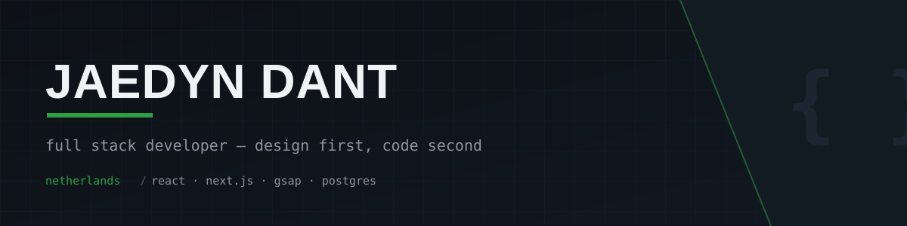

  

### Jaedyn — I design and build custom web experiences.

Not templates. I run a small studio that ships bespoke sites and apps for
restaurants, law firms, dental practices, and car rental businesses — concept
first, code second. Front to back: design, animation, backend, deploy.

 

 

 

### Currently building

- **Van der Tweel** — buyer + office platform for a villa development, Next.js + Drizzle + Postgres, security-hardened (rate limiting, audit log, CSP)
- **Herbot** — autonomous design agency tooling: demo generation, lead sourcing, client delivery pipelines

 

